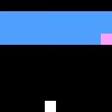
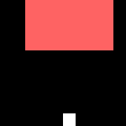
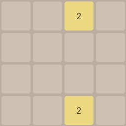

# rl2

Tinkering with RL and other things.

## Results / Open Questions

Entries are ordered from most recent at the top to oldest at the bottom.

### Sample-Efficient Learning

Can RL agents learn effective policies with fewer environment interactions?
Explore ways to make better use of each collected experience.

### Solving Atari57 with a Single Trained Model

Try solving Atari57 with a single trained model using
[multi_atari.py](src/rl2/multi_atari.py).

### Solving Reasoning Problems with reasoning-gym

Try solving reasoning problems with
[reasoning-gym](https://github.com/open-thought/reasoning-gym).

### Learning When to Think or Act in RL

Can RL policies learn to “think” or plan before acting, similar to thinking in
LLMs, with the policy itself deciding how long to think or plan before taking
an action?

### Solving Atari with Program Induction/Synthesis

In Progress

Can program induction or synthesis learn programs that solve Atari games?

### Solving Sparse Reward Atari Environments

In Progress

Solving sparse reward Atari environments, such as Montezuma’s Revenge.

### PPO with JAX-native environments

JAXtari native RGB presets: [Breakout](configs/ppo/jaxtari/breakout.yaml) and
[Space Invaders](configs/ppo/jaxtari/space_invaders.yaml), both with CNN + LSTM policies.
Install sprites once with `uv run python -m jaxtari.install_sprites`.

MinAtar Breakout using [train_ppo.py](src/rl2/train_ppo.py) with the
[Breakout config](configs/ppo/minatar/breakout.yaml).



MinAtar Space Invaders using [train_ppo.py](src/rl2/train_ppo.py) with the
[Space Invaders config](configs/ppo/minatar/space_invaders.yaml).



Pgx 2048 using [train_ppo.py](src/rl2/train_ppo.py) with the
[2048 config](configs/ppo/pgx/2048.yaml).



### PPO with Gym-style environments

[train_ppo_gym.py](src/rl2/train_ppo_gym.py) steps non-JAX-native Gymnasium and
VisFly environments in Python and compiles recurrent policy inference and PPO updates in JAX. It supports
zero-based Discrete and bounded floating-point Box actions, plus Box/Dict/Tuple
observations. `mlp` flattens observation leaves; `conv2d` encodes HWC image leaves
with CNNs and combines them with vector features. Gymnasium observations retain
their original layout; image inputs to `conv2d` must be HWC. VisFly converts CHW
images to HWC by default (`env.channels_first: true`).

```bash
uv run python -m rl2.train_ppo_gym --config configs/ppo_gym.yaml
```

The [VisFly preset](configs/ppo_gym/visfly.yaml) uses NavigationEnv with depth,
state, and target observations. On the local k3s cluster, build the simulator and
bundle its example scenes with:

```bash
./submit.py --visfly -- uv run python -m rl2.train_ppo_gym --config configs/ppo_gym/visfly.yaml
```

The image supplies `VISFLY_SCENE_PATH` and saves checkpoints under `/runs/ppo_gym`.
The first build compiles headless Habitat-Sim; subsequent builds reuse its cache.

For a host installation, install [VisFly's dependencies, modified Habitat-Sim,
and datasets](https://github.com/SJTU-ViSYS-team/VisFly#installation) in a Python
environment compatible with this project's dependencies. VisFly is loaded through
its configurable `env.entry_point`; it is not installed by `uv sync`. Put the parent
of the `VisFly` source directory on `PYTHONPATH`, and set `VISFLY_SCENE_PATH` to the
absolute scene directory, such as `VisFly/datasets/visfly-beta/configs/scenes/garage_simple_l_medium`.
Run from the directory expected by the dataset's relative asset paths.

```bash
python -m rl2.train_ppo_gym --config /path/to/rl2/configs/ppo_gym/visfly.yaml
```

`num_envs` counts agents across scenes and must divide evenly by `env.num_scenes`.
Constructor options go in `env.kwargs`; scene/agent counts, seed, and
`requires_grad=False` are managed by the trainer. VisFly tensors cross the host
boundary as owned NumPy arrays. Both end flags reset recurrent memory; only
nonterminal timeouts bootstrap from the final observation before autoreset.

Evaluation creates separate single-agent environments. Scoring works without RGB
rendering; `eval_video: true` or a positive `video_interval` requires appropriate
`scene_kwargs.render_settings`. Checkpoints save the full configuration, but resume
uses the current configuration and starts fresh environments and recurrent memory.

## Useful links and references

| Link | Description |
| --- | --- |
| [Google DeepMind mctx](https://github.com/google-deepmind/mctx) | Monte Carlo tree search in JAX, with batched, JIT-compiled implementations supporting AlphaZero, MuZero, and Gumbel MuZero. |
| [Programmatically Interpretable Reinforcement Learning](https://proceedings.mlr.press/v80/verma18a.html) | (Verma et al., ICML 2018): Uses a trained neural policy to guide the search for interpretable policies written in a domain-specific language. Relevant to learning programs that play Atari; evaluated on simulated driving in TORCS. |
| [OCAtari: Object-Centric Atari 2600 Reinforcement Learning Environments](https://arxiv.org/abs/2306.08649) | (Delfosse et al., 2023): Extracts structured object observations from Atari games using RAM or vision. Useful for studying programmatic policies over objects and their attributes while separating control learning from perception. |
| [JaxMARL](https://github.com/bold-lab-ai/JaxMARL) | **(jax env)** Multi-agent RL environments and baseline algorithms in JAX, including SMAX and Hanabi, with GPU-parallel simulation and PPO-based baselines such as IPPO and MAPPO. |
| [Pgx](https://github.com/sotetsuk/pgx) | **(jax env)** JAX-native game environments, including chess, shogi, Go, and backgammon, with GPU-accelerated parallel simulation and AlphaZero and PPO training examples. |
| [XLand-MiniGrid](https://github.com/dunnolab/xland-minigrid) | **(jax env)** JAX-based grid-world environments and benchmarks for meta-reinforcement learning, inspired by XLand and MiniGrid, with composable rules and goals and multi-GPU PPO baselines. |
| [DiscoRL](https://github.com/google-deepmind/disco_rl) | A minimal JAX framework for meta-learning RL update rules, with pretrained Disco103 weights and notebooks for training agents with the discovered rule or learning new rules. |
| [minimax](https://github.com/facebookresearch/minimax) | **(jax env)** JAX-based unsupervised environment design baselines for automatic curricula, including PAIRED, Prioritized Level Replay, and ACCEL, with multi-device training support. |
| [JaxUED](https://github.com/DramaCow/jaxued) | **(jax env)** Unsupervised environment design in JAX, with readable single-file implementations of domain randomization, Prioritized Level Replay, ACCEL, and PAIRED, plus reusable level-sampling utilities. |
| [Brax](https://github.com/google/brax) | **(jax env)** JAX-based physics simulation and RL training, including PPO and SAC, with accelerator-parallel execution. Active development focuses on training, with support for MuJoCo Playground environments. |
| [Crazyflow](https://github.com/learnsyslab/crazyflow) | **(jax env)** Single-drone continuous-control tasks for PPO. See [drone adapters](docs/drone_envs.md). |
| [CrazyRL](https://github.com/ffelten/CrazyRL) | **(jax env)** Multi-drone tasks with continuous actions through the MAPPO/IPPO entry point. See [drone adapters](docs/drone_envs.md). |
| [Gymnax](https://github.com/RobertTLange/gymnax) | **(jax env)** JAX RL environments spanning classic control, MinAtar, and meta-RL tasks, with vectorized rollouts. |
| [MuJoCo Playground](https://github.com/google-deepmind/mujoco_playground) | **(jax env)** GPU-accelerated environments for robot learning and sim-to-real transfer. |
| [Jumanji](https://github.com/instadeepai/jumanji) | **(jax env)** JAX RL environments for logic puzzles, packing, and routing problems. |
| [Craftax](https://github.com/MichaelTMatthews/Craftax) | **(jax env)** JAX RL environment extending Crafter with roguelike mechanics inspired by NetHack. |
| [Navix](https://github.com/epignatelli/navix) | **(jax env)** Accelerated MiniGrid environments implemented in JAX. |
| [Kinetix](https://github.com/FLAIROx/Kinetix) | **(jax env)** JAX environments for RL on general 2D physics tasks. |
| [JAXtari](https://github.com/k4ntz/JAXtari) | **(jax env)** GPU-accelerated Atari environments in JAX, with pixel and object observations and customizable game mechanics. |
| [continual-foragax](https://pypi.org/project/continual-foragax/) | **(jax env)** JAX grid-world environments for continual learning, with customizable biomes, object placement, respawning, rewards, and multiple observation modalities. |

## ray prof


| Tool | What it answers |
|---|---|
| **Ray Timeline** | Which actor/task ran when? Where did calls overlap or wait? |
| **py-spy** — available through Dashboard | Which Python functions consume CPU? Where is a worker stuck? Can include subprocesses. |
| **Memray** — Dashboard integration | Where is CPU memory allocated? What causes growth or leaks? |
| **Nsight Systems** | What happens across CPU processes, GPU kernels, memory copies, and NCCL transfers? |
| **JAX profiler / XProf** | Why is the learner slow? Compilation, XLA operations, device execution, and GPU memory. |
| **vLLM’s PyTorch profiler** | Where does inference time go inside vLLM workers? |
| **OpenTelemetry tracing** | Which model request or environment step delays a rollout across service/process boundaries? |
| **Prometheus + Grafana** | How do utilization, memory, throughput, and queue metrics change over a long run? |
