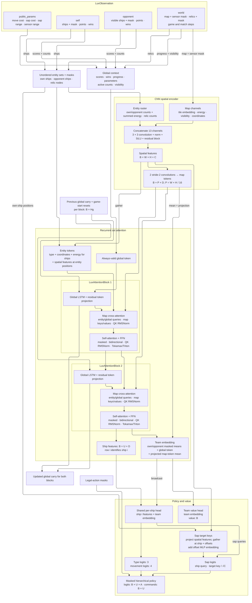

# Lux Design S3 environment

[Lux AI Season 3](https://github.com/Lux-AI-Challenge/Lux-Design-S3) is a
two-team strategy game implemented in JAX. With the default game settings:

- **Setup:** Two teams play on a symmetric 24 × 24 map. Each controls up to 16
  ships, which spawn periodically at the team's starting corner.
- **Game length:** A game contains five matches, each with 100 action-bearing
  steps. Ships and match points reset between matches; map progression and game
  parameters persist.
- **Turns:** Both teams act simultaneously. Each ship can stay still, move one
  tile up/right/down/left, or sap energy from enemy ships around a target tile.
- **Visibility:** Ships reveal nearby tiles through fog of war. Teams must
  explore to discover opponents, relics, and scoring locations. Competition game
  parameters are randomized once per game, and many must be inferred through play.
- **Terrain and energy:** Asteroids block movement. Nebulae reduce vision and can
  drain energy. Tile energy fields recharge or drain ships; moving and sapping
  cost energy, so ships need enough energy to perform their chosen action.
- **Combat:** Sapping and adjacent enemies can drain ship energy. When opposing
  ships occupy the same tile, the team with more combined energy there survives;
  a tie removes both sides. Ships with negative energy are removed.
- **Scoring:** Occupying a hidden scoring tile near a relic earns one point per
  step. Multiple friendly ships on the same tile still earn only one point.
  Discover these tiles by exploring and observing score changes.
- **Winning:** The team with more points at match end wins that match. Ties use
  total ship energy, then a random winner. Win the most matches to win the game.
- **Strategy:** Balance early exploration with holding scoring tiles and denying
  them to the opponent. Retain knowledge across matches to improve later decisions.

## Core JAX API

```python
import jax
import jax.numpy as jnp
from luxai_s3.env import LuxAIS3Env
from luxai_s3.params import EnvParams

params = EnvParams()
env = LuxAIS3Env(auto_reset=False, fixed_env_params=params)
reset_key, step_key = jax.random.split(jax.random.key(0))  # Two scalar PRNG keys.
obs, state = env.reset(reset_key, params=params)  # Pytrees; shapes below.
actions = {
    player: jnp.zeros((params.max_units, 3), dtype=jnp.int16)  # (U, 3)
    for player in ("player_0", "player_1")
}
obs, state, rewards, terminated, truncated, info = env.step(
    step_key, state, actions, params=params
)  # Rewards and done flags: dictionaries of scalar arrays, one per player.
```

`reset` returns `(obs, state)`; `step` returns six values as shown above.
Both methods are JIT compiled. `jax.vmap` can batch keys, states, and actions;
keep `params` shared with `in_axes=None`, or batch its dynamic leaves when
randomizing games. `fixed_env_params` controls static dimensions and must agree
with the corresponding dimensions in runtime parameters.

Actions are dictionaries keyed by `player_0` and `player_1`, each holding an
integer array of shape `(U, 3)`. Each row is `[action_type, dx, dy]`: 0 stays,
1 moves up, 2 right, 3 down, 4 left, and 5 saps. Only sap uses the relative target
offsets; both absolute offsets must be at most `unit_sap_range`. Actions for both
teams are submitted in the same environment step.

Each player's observation is an `EnvObs` pytree. With defaults, `T=2` teams,
`U=16` unit slots per team, `W=H=24` map dimensions, and `R=6` relic slots:

| Field | Shape | Meaning |
|---|---|---|
| `units.position` | `(T, U, 2)` | Unit coordinates `(x, y)` |
| `units.energy` | `(T, U)` | Observed energy; state energy instead has shape `(T, U, 1)` |
| `units_mask` | `(T, U)` | Present and observable units |
| `sensor_mask` | `(W, H)` | Visible tiles |
| `map_features.energy` | `(W, H)` | Tile energy |
| `map_features.tile_type` | `(W, H)` | Empty 0, nebula 1, asteroid 2 |
| `relic_nodes` | `(R, 2)` | Visible relic coordinates |
| `relic_nodes_mask` | `(R,)` | Visible relic slots |
| `team_points`, `team_wins` | `(T,)` each | Current match points and cumulative match wins |
| `steps`, `match_steps` | `()` each | Game and match step counters |

Hidden fields use `-1`; use the masks, since tile energy can also be negative.
Team indices remain absolute in both players' observations. The full `EnvState`
contains hidden information and must not be used directly as the policy input.
Upstream's `observation_space` and `state_space` are placeholders, so derive
model shapes from the actual pytrees.

## Rewards, resets, and randomization

- `rewards[player]` is the player's **cumulative match wins**, not a per-step
  increment or the current relic-point score. For incremental match rewards,
  subtract the previous state's `team_wins`.
- A match has 100 action-bearing steps plus a boundary frame. The default game
  ends after 505 calls to `step`, with `truncated[player] = True` for both players;
  `terminated[player]` remains false. It runs all five matches.
- Match boundaries reset units and match points while retaining map progression
  and game parameters. Preserve agent memory across matches for adaptation.
- With `auto_reset=False`, explicitly reset after game truncation. With
  `auto_reset=True`, returned state/observations reset at game end;
  `info["final_state"]` and `info["final_observation"]` retain the transition result.
- Core `reset` randomizes the map but uses the supplied parameter values.
  `luxai_s3.wrappers.LuxAIS3GymEnv` samples game parameters from
  `env_params_ranges` on reset; its host-side wrapper is separate from the pure
  JAX API. Its reset info includes privileged `full_params` and `state` fields.

## Model architecture

[LuxActorCritic](../src/rl2/model/lux.py) processes each team's visible observation.
The diagram shows `step` with batch size `B` and `U` own-ship slots;
`__call__` adds a time axis after `B` and scans the global-token LSTMs over that axis.
`D` is `model.heads * model.head_dim`; `C` is `model.channels`;
`Hg` is `model.recurrent.hidden_size`; `A` is commands per ship (230).

The default model has 4,661,464 parameters: CNN width 64, attention width 256
(eight 32-wide heads with per-head RMSNorm on queries/keys, 1024-wide self-attention FFNs),
two blocks of global-token LSTM → map cross-attention → self-attention,
256-wide single-layer global LSTMs, and 192-wide team embeddings and policy/value
hidden layers.



Token order is global → own ships → opponent ships → relics.
Reordering own ships permutes policy rows while global carry and value remain
invariant. Opponent/relic ordering and masked padding do not affect outputs.
Each block updates only its global token recurrently, then applies map
cross-attention and self-attention + FFN to all valid tokens.
`model.num_blocks` defaults to 2; blocks have separate parameters and global
memory. Each LSTM scans time independently; CNN and attention remain batched
over timesteps, equivalent to repeated `step`.
Global memory persists across ship deaths and matches and resets with the game.
There is no per-ship carry or lifecycle reset tracking.

## rl2 integration

[LuxEnv](../src/rl2/envs/lux_env.py) implements `BaseMultiAgentEnv` with **two team
agents**. Run `uv run mappo --config configs/mappo/lux.yaml` to train both teams
with shared policy weights and separate recurrent memory.

Set `env.map_size` in the training configuration; the adapter default is 24×24.
Map sides must be multiples of eight. Map size changes activation memory but
not model parameter shapes. Rendering scales the board to fit its panel.

- Each team policy call receives one structured observation and outputs all 16 ship
  commands. Each ship has a stay/move/sap choice, with a conditional direction
  or sap target. All ships share the encoder and recurrent blocks and sample independently
  given that representation; this is not an autoregressive joint-action model.
  Raw logits have shape `(..., U, 232)`: 3 type, 4 direction, and 225 target logits.
  Masked hierarchical probabilities flatten to `(..., U, 230)` command logits.
  Equal type logits give equal mass to available types, independent of target
  count; unavailable branches receive zero mass. Entropy includes conditional
  entropy weighted by type probability. This changes the policy head shape;
  checkpoints from the flat 230-logit head require a fresh model.
- Adapter actions have shape `(2, U)`, with 230 categories per ship. IDs 0–4 are
  stay/up/right/down/left. For ID `a >= 5`, sap offsets are
  `dx = (a - 5) // 15 - 7`, `dy = (a - 5) % 15 - 7`. The adapter converts them to
  Lux's `(U, 3)` arrays. Masks have shape `(2, U, 230)` and exclude absent ships,
  insufficient energy, out-of-range/off-map sap targets, and boundary-frame
  actions; stay is always allowed. Failed movement attempts remain available.
- `AgentObservation[LuxObservation]` has `self` and `opponent` team views,
  each containing `units.position`, `units.energy`, `units_mask`, `points`, and
  `wins`. Both use the acting player's visibility; opponent data never comes
  from the opponent's private observation. The outer axis remains
  `[player_0, player_1]`; ship positions have shape `(2, U, 2)` per team view.
- Sensor masks, map features, relics, and step counters are grouped under
  `world: LuxWorldObservation` in each observation. `public_params` is `(2, 4)`:
  move cost, sap cost, sap range, and sensor range. Native dtypes, units, and
  absolute coordinates are retained.
  `LuxEnv.observation_space` describes one player's tree with
  `ShapeDtypeStruct` leaves, excluding action masks.
- MAPPO's `model.type: lux` encodes the spatial map with a residual CNN.
  Own ships, visible opponent ships, and visible relic nodes are separate typed
  entities in one set. Tokens combine physical coordinates and local map features;
  ships also carry energy. There are no slot-index embeddings.
  Each recurrent block applies map cross-attention followed by bidirectional
  self-attention with residual feed-forward layers. Masks exclude hidden/absent entities;
  an always-valid global token handles empty sets. Padding capacity does not
  affect features; active ship counts use a fixed scale of 16.
- Each block runs an LSTM over the global token before map retrieval and
  entity mixing. Its output is projected and added to the global token. Final
  ship tokens and the invariant team embedding feed the command heads.
  Sap scores use target-map features plus an offset MLP: normalized
  `[dx, dy, |dx|, |dy|]` → Dense(C) → SiLU → Dense(C). Ship permutations
  permute policy rows; opponent/relic permutations leave commands unchanged.
  Invariant summaries feed the value head. Hidden scoring tiles
  are never inputs, and legality masks preserve the environment's command order.
- `model.channels` controls CNN width and requires positive even channels;
  attention width is `model.heads * model.head_dim`.
  `model.embedding_size` controls team and head widths;
  `model.recurrent` configures the single global-token LSTM in each block,
  without stacking or intermediate MLPs.
  `model.attention_implementation` defaults to `triton`: both attention paths
  call Tokamax's Triton kernel.
  Explicit `xla` selects Tokamax's CPU-compatible reference implementation.
  This architecture requires a fresh run directory; previous checkpoints are
  incompatible. Playing-strength improvements require training evaluation.
- Omitting `model.type` selects `generic`, the flat MLP model. `make_actor_critic`
  constructs `GenericActorCritic` or `LuxActorCritic`, both implementing
  `BaseActorCritic` with their own observation and policy types.
- PPO computes one joint log probability and one value per **team**. Log
  probabilities and entropies sum over ship commands. PPO batches retain two
  team sequences per environment; each carry contains only per-block global
  cell/hidden state `(B, Hg)`.
- Rewards are increments in match wins: the match winner receives 1 and the
  other team 0. Global memory persists through ship deaths and match boundaries.
  Completing the whole game is treated as terminal, with no value bootstrap,
  even though upstream labels it a truncation. Same-step autoreset preserves
  final observations/state and samples fresh game parameters.
  Batched autoreset skips map generation when no game finishes; otherwise it
  resets in parallel and selects fresh state only for completed games.
- Parameters are randomized once per game by default. `randomize_params: false`
  uses native defaults. `max_units`, `max_steps_in_match`, and `match_count`
  can reduce the game for experiments. Map dimensions remain 24 × 24.
- The trainer averages agent returns for episode metrics. With both opposing
  teams included, a completed game always has mean return `match_count / 2`;
  this is not a playing-strength metric. A fixed-opponent evaluation is not yet
  implemented. The headless renderer shows the full map and active scoring tiles,
  match/turn progress, team relic points, wins, active ships, and energy. Points
  display as `--` at match boundaries because the simulator has already reset them.
  Each scorecard counts distinct active scoring tiles currently occupied by that
  team's ships with nonnegative energy; stacked ships count once and absent ships
  are excluded. This is current occupancy, not the previous turn's points gained.
  Tile energy uses an orange–neutral–teal scale fixed to the parameter bounds,
  with outlined nebulae and solid asteroids. The separate nebula drain is labeled;
  the heatmap shows raw tile energy before that penalty.
  Blue/red outlines on the main map trace each team's current sensor coverage,
  including unseen holes; shared boundaries alternate team colors. They show
  current visibility, not remembered exploration; the map remains privileged.
  Single ships have energy bars scaled to `max_unit_energy`, separated from the
  ship marker by one pixel; stacked ships show a count badge instead. Bars and
  badges are omitted when tiles are under 10 pixels wide. Frames are 640 × 416 pixels.
  The board is 288 × 288 pixels; larger maps are downsampled and can omit individual
  tiles and their markers. Team statistics still include all active ships and tiles.

The AlphaZero trainer remains separate and still requires a PGX-compatible
adapter and search design for Lux's hidden information and simultaneous actions.

Upstream references: [game rules](https://github.com/Lux-AI-Challenge/Lux-Design-S3/blob/c6d1e665d12a467b299fb586b3f876e47847746b/docs/specs.md),
[environment implementation](https://github.com/Lux-AI-Challenge/Lux-Design-S3/blob/c6d1e665d12a467b299fb586b3f876e47847746b/src/luxai_s3/env.py),
[parameters](https://github.com/Lux-AI-Challenge/Lux-Design-S3/blob/c6d1e665d12a467b299fb586b3f876e47847746b/src/luxai_s3/params.py),
and [Gym wrapper](https://github.com/Lux-AI-Challenge/Lux-Design-S3/blob/c6d1e665d12a467b299fb586b3f876e47847746b/src/luxai_s3/wrappers.py).
