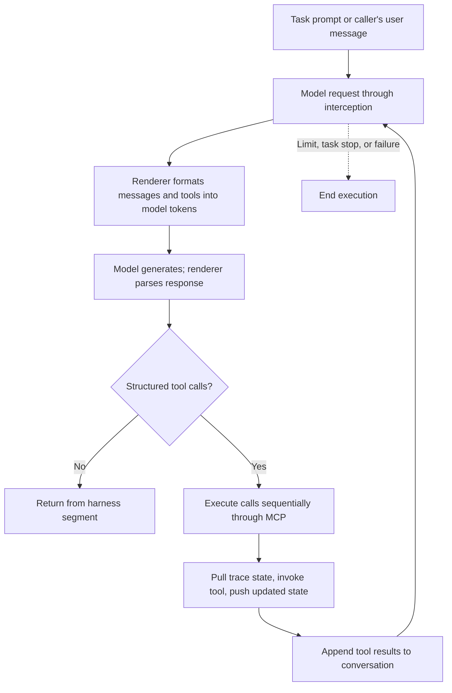

# Verifiers agent lifecycle

Reference for this repository's installed Verifiers 0.4.0 implementation, inspected
on 2026-10-21. The execution examples assume our `null` harness and subprocess
runtime. Other harnesses can interpret assistant output differently.

## Objects and ownership

| Object | Responsibility |
| --- | --- |
| `vf.Task` | Episode description, configuration, toolset factory, lifecycle hooks, stop rules, and scoring. It is already an instance, not a live ALFWorld environment. |
| `vf.Agent` | Model, renderer, sampling, harness, runtime policy, and limits. Can run independent rollouts of the same task. |
| `Rollout` | One execution: trace, runtime, tool servers, harness session, and cleanup. |
| `ALFWorldTools` | Owns one live environment and exposes its actions as tools. |
| `Trace` | Recorded conversation, calls, synchronized state, rewards, timing, and completion status. |
| `Interaction` | Caller-facing handle for sending user turns into an open rollout. |

`task.toolsets(config)` constructs toolset definitions; `setup_task(task)` creates
the live ALFWorld environment in its tool-server process. Verifiers also calls
`toolsets()` during configuration validation, so environment creation belongs in
`setup_task()`, not in the toolset factory.

## `agent.run(task)`: complete lifecycle

```text
Agent.run(task)
  └─ retry loop, if configured
      └─ Agent._run_once(...)
          ├─ _rollout_params(...): resolve runtime, validate pairing, resolve limits
          ├─ Rollout(...): create trace and execution state
          ├─ await Rollout.open()
          │   ├─ create/start owned runtime, or use borrowed runtime
          │   ├─ runtime.prepare_setup()
          │   ├─ task.setup(trace, runtime)
          │   ├─ harness.setup(runtime)
          │   ├─ task.toolsets(task.config)
          │   ├─ serve_interception(...): model routing, task/state channels, tracing
          │   ├─ serve_tools(...): launch task-scoped MCP servers
          │   │   └─ server process starts
          │   │       ├─ server.setup()
          │   │       ├─ _setup_task_from_channel(...)
          │   │       │   ├─ fetch/deserialise task data from /task
          │   │       │   └─ await server.setup_task(task_data)
          │   │       │       └─ ALFWorldTools: construct ALFWorld, init_env, reset
          │   │       ├─ register tools and lifespan
          │   │       └─ serve MCP requests over HTTP
          │   ├─ runtime.prepare_execution(...)
          │   └─ harness.session(...): prepare conversation session
          ├─ await Rollout.step() if opening succeeded
          │   └─ one harness segment (model/tool loop below)
          ├─ mark agent_completed if still active
          └─ await Rollout.close()
              ├─ close harness session
              ├─ close tool servers and interception
              │   └─ ALFWorldTools lifespan closes its environment
              ├─ task.finalize(trace, runtime), if eligible
              ├─ task.score(...) and harness.score(...), if eligible
              ├─ mark trace completed and record timing/status
              ├─ harness.cleanup(...)
              ├─ stop owned runtime; borrowed runtime stays with its owner
              └─ return Trace
```

Task `setup()` and tool-server `setup_task()` are different hooks. Our ALFWorld task
uses the default no-op task setup; its toolset creates the environment.
Finalization and scoring normally run for successful or stopped rollouts, including
partial trajectories, but are skipped when the run has already failed. Tools are
already shut down at that point; the runtime remains available until final cleanup.

### Inside one harness segment



For the `null` harness, an assistant response without tool calls ends the segment.
One segment can contain many model generations and tool calls. It is not one model
generation, one environment action, or one `interaction.turn()` user message.
Limits and task stop rules can prevent further execution before a text answer.

In ALFWorld, the first `look()` returns the initial observation without stepping.
Action tools update `done` and `reward` in synchronized trace state;
`alfworld_done` stops the rollout when that state says the episode is finished.

## `agent.interaction(task)`: caller-driven exchange

This uses the same `Rollout.open()` and `Rollout.close()` paths, but keeps the
runtime, environment, and conversation alive between segments.

```text
async with agent.interaction(task) as interaction:
  │ context entry: create Rollout(has_user=True), await Rollout.open()
  │
  ├─ await interaction.turn()             # prompted task's opening segment
  │   └─ Rollout.step() → model/tool loop → Segment
  │
  ├─ caller inspects the result and decides the next user message
  │   environment remains alive; no new setup/reset
  │
  ├─ await interaction.turn("next input")
  │   └─ Rollout.step(user_messages) → resumed model/tool loop → Segment
  │
  └─ repeat while execution is permitted

context exit:
  └─ Interaction.close()
      ├─ cancel pending deliveries
      ├─ mark user_closed if still active
      └─ Rollout.close(): cleanup, finalization, scoring, runtime teardown

interaction.trace contains the completed trace after context exit.
```

If `task.data.prompt` is present, the first call must be `turn()` with no message.
If the task has no prompt, the first call must supply a message. Later turns supply
messages. The caller can be a human-facing application, script, environment, or
another agent; Verifiers does not automatically generate those user messages.

`turn()` returns a `Segment`, not the final `Trace`. It includes the segment's
messages and can report `terminated=True` when execution cannot proceed. A segment
that produced a response can still be returned even if a limit was reached; a
subsequent turn can report termination. Limits apply across the whole rollout;
they do not reset for each caller message.

| Behavior | `run()` | `interaction()` |
| --- | --- | --- |
| Initial setup | Once per attempt | Once on context entry |
| Text-only answer | Ends the segment, then closes the rollout | Ends the segment and returns control to the caller |
| Additional user turns | No caller-driven continuation | Caller supplies them with `turn(message)` |
| Environment between segments | Rollout closes after its segment | Preserved until context exit or explicit close |
| Result | Completed `Trace` | `Segment` per turn; completed trace after close |
| Automatic retries | Configured retryable failures; no retry into a borrowed runtime | No automatic whole-exchange retries |

## Our trainer and ALFWorld

The trainer calls `agent.run(task.defer_scoring())` for ALFWorld. The deferred task
is a deep copy that skips task rewards, metrics, and judges during normal close.
Environment setup, stop rules, finalization, and harness scoring still run.

After the group's rollouts finish, `score_group()` checks that their traces did not
fail, calls the original `task.score(trace)` on each, and computes advantages.
ALFWorld scoring reads `trace.state.reward`; it does not need a live environment.

Each rollout currently gets its own task-scoped tool-server subprocess and
`init_env(batch_size=1)` environment. There is no shared environment pool. Tools
are ordinary synchronous functions: Verifiers awaits state synchronization but
invokes the tool directly, so construction, reset, and stepping block that server's
event loop. The actor awaits HTTP results asynchronously, allowing other rollouts
to proceed. Declaring those functions `async` alone would not offload their work.

With the current Qwen3 model, the default renderer parses tool calls for execution.
Thinking is enabled: the generation prefix ends at the assistant header, without
prefilling an empty thinking section. ToolRL instead uses our custom response parser
to preserve output tags as text for grading; its proposed calls are not executed.

## Failure and cancellation

- Setup/model/tool failures are normally recorded in the trace. `run()` can retry
  configured retryable failures with a fresh rollout after cleanup.
- `interaction()` setup failures raise before yielding the handle. Ordinary
  exceptions inside the context mark the rollout failed and propagate.
- Cancellation uses `Rollout.abort()` to release the harness session, servers, and
  owned runtime without task finalization or scoring. `run()` shields abort cleanup.
- The ALFWorld lifespan wrapper places environment cleanup inside HTTP shutdown
  and preserves MCP's original lifespan. It also covers partial environment setup
  through the toolset's exit stack.

## Source map

Local dependency links require the project's Python 3.12 `.venv`; method names are
the lookup points if dependency layout changes.

| Source | Methods to inspect |
| --- | --- |
| [agent.py](../.venv/lib/python3.12/site-packages/verifiers/v1/agent.py) | `Agent.run`, `_run_once`, `interaction`, `_rollout_params`; `Interaction.turn`, `_turn`, `close` |
| [rollout.py](../.venv/lib/python3.12/site-packages/verifiers/v1/rollout.py) | `Rollout.open`, `step`, `close`, `abort` |
| [task.py](../.venv/lib/python3.12/site-packages/verifiers/v1/task.py) | `Task.setup`, `finalize`, `defer_scoring`, `score` |
| [mcp/launch.py](../.venv/lib/python3.12/site-packages/verifiers/v1/mcp/launch.py) | `serve_tools`, `serve` |
| [mcp/server.py](../.venv/lib/python3.12/site-packages/verifiers/v1/mcp/server.py) | `ServerBase._serve`, `_setup_task_from_channel`, `_with_state` |
| [harnesses/utils/core.py](../.venv/lib/python3.12/site-packages/verifiers/v1/harnesses/utils/core.py) | `run_chat_loop` |
| [alfworld_env.py](../src/rl2/alfworld_env.py) | `ALFWorldTools.setup_task`, `register`, action tools; `ALFWorldTask` stop/reward hooks |
| [train_grpo_v2.py](../src/rl2/train_grpo_v2.py) | `create_agent`, rollout collection, `score_group` |
