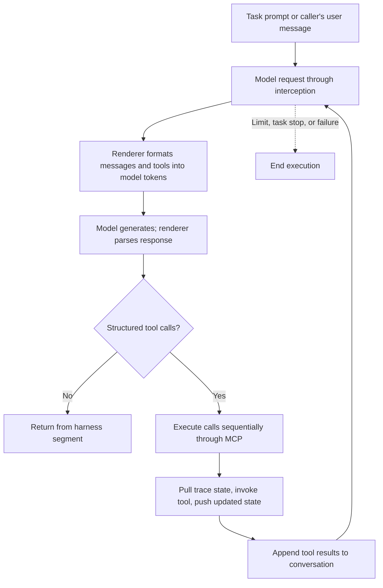

# Verifiers agent lifecycle

Reference for Verifiers 0.4.0, inspected on 2026-10-21. The model/tool loop below
describes the `null` harness with a renderer-backed training client. Other harnesses
and clients can handle model requests and assistant output differently.

## Objects and ownership

| Object | Responsibility |
| --- | --- |
| `vf.Task` | Episode description, configuration, toolset factory, lifecycle hooks, stop rules, and scoring. Passed to the agent as an instance. |
| `vf.Agent` | Model, renderer, sampling, harness, runtime policy, and limits. Can run independent rollouts of the same task. |
| `Rollout` | One execution: trace, runtime, tool servers, harness session, and cleanup. |
| `vf.Toolset` | Defines MCP tools and server lifecycle hooks, including task-specific initialization. |
| `Trace` | Recorded conversation, calls, synchronized state, rewards, timing, and completion status. |
| `Interaction` | Caller-facing handle for sending user turns into an open rollout. |

`task.toolsets(config)` constructs toolset definitions; server `setup_task(task_data)`
initializes task-specific resources. Verifiers also calls `toolsets()` during
configuration validation, so the factory should not allocate live resources.

## `agent.run(task)`: complete lifecycle

```text
Agent.run(task)
  └─ retry loop, if configured
      └─ Agent._run_once(...)
          ├─ _rollout_params(...): resolve runtime, validate pairing, resolve limits
          ├─ Rollout(...): create trace and execution state
          ├─ await Rollout.open()
          │   ├─ create/start owned runtime, or use borrowed runtime
          │   ├─ runtime.prepare_setup()
          │   ├─ task.setup(trace, runtime)
          │   ├─ harness.setup(runtime)
          │   ├─ task.toolsets(task.config)
          │   ├─ serve_interception(...): model routing, task/state channels, tracing
          │   ├─ serve_tools(...): launch task-scoped MCP servers
          │   │   └─ server process starts
          │   │       ├─ server.setup()
          │   │       ├─ _setup_task_from_channel(...)
          │   │       │   ├─ fetch/deserialise task data from /task
          │   │       │   └─ await server.setup_task(task_data)
          │   │       ├─ register tools
          │   │       └─ serve MCP requests over HTTP
          │   ├─ runtime.prepare_execution(...)
          │   └─ harness.session(...): prepare conversation session
          ├─ await Rollout.step() if opening succeeded
          │   └─ one harness segment (model/tool loop below)
          ├─ mark agent_completed if still active
          └─ await Rollout.close()
              ├─ close harness session
              ├─ close tool servers and interception
              ├─ task.finalize(trace, runtime), if eligible
              ├─ task.score(...) and harness.score(...), if eligible
              ├─ mark trace completed and record timing/status
              ├─ harness.cleanup(...)
              ├─ stop owned runtime; borrowed runtime stays with its owner
              └─ return Trace
```

Task `setup(trace, runtime)` and tool-server `setup_task(task_data)` are different
hooks; both default to no-ops. The diagram shows newly launched task-scoped servers.
`serve_tools()` can also connect to configured endpoints or borrow shared servers
whose lifetime is managed by their owner.

Finalization and scoring normally run for successful or stopped rollouts, including
partial trajectories, but are skipped when the run has already failed. Tools are
already shut down at that point; the runtime remains available until final cleanup.

### Inside one harness segment



For the `null` harness, an assistant response without tool calls ends the segment.
One segment can contain many model generations and tool calls. Each
`interaction.turn()` runs one segment, rather than necessarily one model generation.
Limits and task stop rules can prevent further execution before a text answer.

## `agent.interaction(task)`: caller-driven exchange

This uses the same `Rollout.open()` and `Rollout.close()` paths, but keeps the
runtime, tool servers, and conversation alive between segments.

```text
async with agent.interaction(task) as interaction:
  │ context entry: create Rollout(has_user=True), await Rollout.open()
  │
  ├─ await interaction.turn()             # prompted task's opening segment
  │   └─ Rollout.step() → model/tool loop → Segment
  │
  ├─ caller inspects the result and decides the next user message
  │   runtime and tool servers remain alive; setup does not repeat
  │
  ├─ await interaction.turn("next input")
  │   └─ Rollout.step(user_messages) → resumed model/tool loop → Segment
  │
  └─ repeat while execution is permitted

context exit:
  └─ Interaction.close()
      ├─ cancel pending deliveries
      ├─ mark user_closed if still active
      └─ Rollout.close(): cleanup, finalization, scoring, runtime teardown

interaction.trace contains the completed trace after context exit.
```

If `task.data.prompt` is present, the first call must be `turn()` with no message.
If the task has no prompt, the first call must supply a message. Later turns supply
messages. The caller can be a human-facing application, script, environment, or
another agent; Verifiers does not automatically generate those user messages.

`turn()` returns a `Segment`, not the final `Trace`. It includes the segment's
messages and can report `terminated=True` when execution cannot proceed. A segment
that produced a response can still be returned even if a limit was reached; a
subsequent turn can report termination. Limits apply across the whole rollout;
they do not reset for each caller message.

| Behavior | `run()` | `interaction()` |
| --- | --- | --- |
| Initial setup | Once per attempt | Once on context entry |
| Text-only answer | Ends the segment, then closes the rollout | Ends the segment and returns control to the caller |
| Additional user turns | No caller-driven continuation | Caller supplies them with `turn(message)` |
| Resources between segments | Rollout closes after its segment | Preserved until context exit or explicit close |
| Result | Completed `Trace` | `Segment` per turn; completed trace after close |
| Automatic retries | Configured retryable failures; no retry into a borrowed runtime | No automatic whole-exchange retries |

## Deferred scoring

`task.defer_scoring()` returns a deep copy that skips task rewards, metrics, and
judges during normal close. Setup, stop rules, finalization, and harness scoring
still run. The caller can later score the completed trace using the original task.
Scoring after runtime teardown requires a scorer that can operate without that
live runtime.

## Tool execution and state

`ServerBase._with_state()` wraps tool calls with state synchronization when the
toolset declares a custom state class: pull state, invoke the tool, then push
changed state. The wrapper calls synchronous functions directly and awaits their
return value only if it is awaitable. It does not automatically offload synchronous
work to a thread; blocking code blocks the tool server's event loop.

The `null` harness executes calls from a model response sequentially. State updates
replace the whole state, so concurrent writes through other callers can overwrite
one another. Resource placement and lifetime depend on runtime and toolset
configuration; shared servers need not be created anew for each rollout.

## Failure and cancellation

- Setup/model/tool failures are normally recorded in the trace. `run()` can retry
  configured retryable failures with a fresh rollout after cleanup.
- `interaction()` setup failures raise before yielding the handle. Ordinary
  exceptions inside the context mark the rollout failed and propagate.
- Cancellation uses `Rollout.abort()` to release the harness session, servers, and
  owned runtime without task finalization or scoring. `run()` shields abort cleanup.

## Source map

Local dependency links assume a Python 3.12 `.venv`; method names are
the lookup points if dependency layout changes.

| Source | Methods to inspect |
| --- | --- |
| [agent.py](../.venv/lib/python3.12/site-packages/verifiers/v1/agent.py) | `Agent.run`, `_run_once`, `interaction`, `_rollout_params`; `Interaction.turn`, `_turn`, `close` |
| [rollout.py](../.venv/lib/python3.12/site-packages/verifiers/v1/rollout.py) | `Rollout.open`, `step`, `close`, `abort` |
| [task.py](../.venv/lib/python3.12/site-packages/verifiers/v1/task.py) | `Task.setup`, `finalize`, `defer_scoring`, `score` |
| [mcp/launch.py](../.venv/lib/python3.12/site-packages/verifiers/v1/mcp/launch.py) | `serve_tools`, `serve` |
| [mcp/server.py](../.venv/lib/python3.12/site-packages/verifiers/v1/mcp/server.py) | `ServerBase._serve`, `_setup_task_from_channel`, `_with_state` |
| [harnesses/utils/core.py](../.venv/lib/python3.12/site-packages/verifiers/v1/harnesses/utils/core.py) | `run_chat_loop` |
